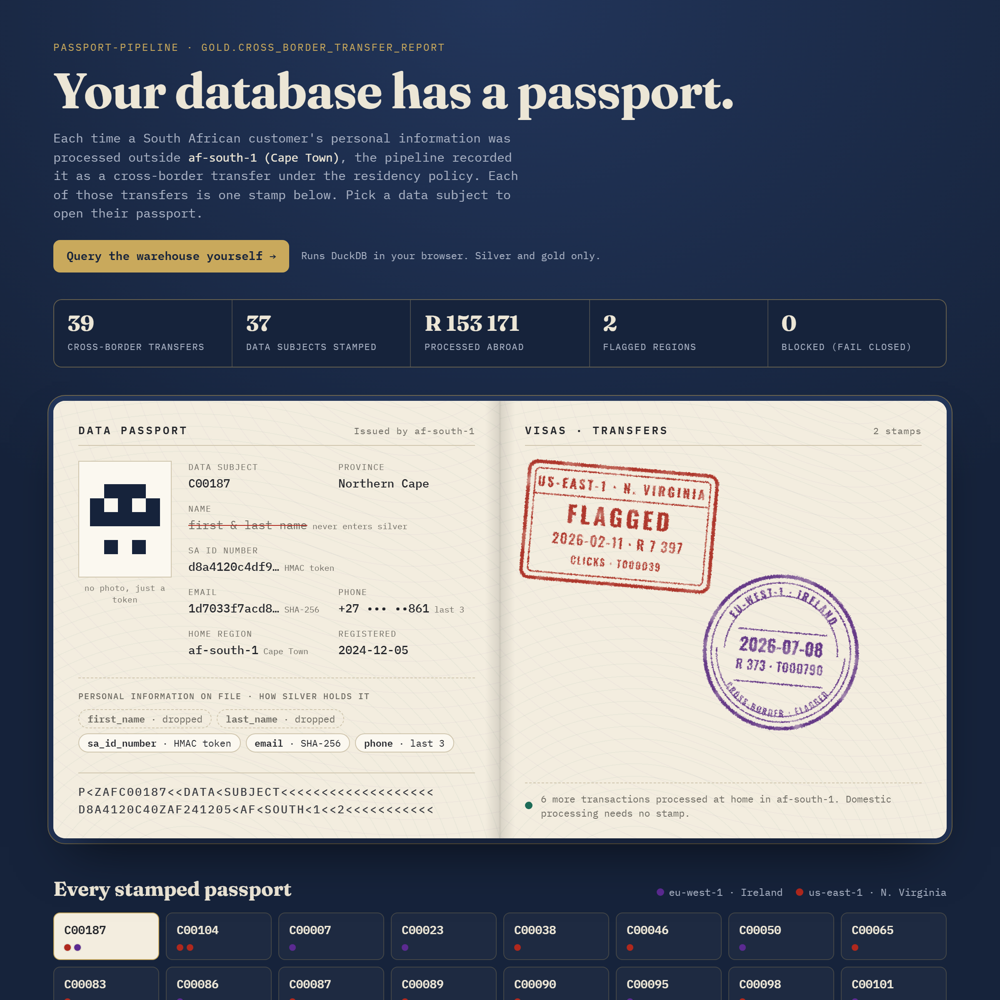

# passport-pipeline

[](https://github.com/Kananelodev/passport-pipeline/actions/workflows/ci.yml)

> *"Your database has a passport."* — Precious Mamotingoe Lesupi, BBD Escape
>
> A local-first batch data pipeline that treats data residency, PII, and trust
> as **engineering constraints baked into the design** — not paperwork bolted on
> at the end.

This is a portfolio project I'm building to go deep on data-engineering
fundamentals before moving to cloud-specific certs and roles. It's deliberately
**local-first and free to run** (no paid AWS account needed), but structured so
that every stage maps cleanly onto managed cloud services later.

## See it live

- **[The passport](https://kananelodev.github.io/passport-pipeline/)**: every cross-border transfer in the gold layer, stamped into its data subject's passport.
- **[Query the passport](https://kananelodev.github.io/passport-pipeline/query.html)**: run SQL against silver and gold in your browser (DuckDB-WASM). Bronze is deliberately not published.

[](https://kananelodev.github.io/passport-pipeline/)

Both pages are rebuilt by CI on every push with a test-only tokenisation key, so
nothing derived from a real key is ever published. To preview them locally, run
`make run`, then `make site`, then `make serve`, and open http://localhost:8000. The query console
needs to be served over http: opening `site/query.html` straight from disk won't
start DuckDB-WASM.

---

## The idea

Synthetic South African customer + transaction data flows through a classic
three-layer ("medallion") pipeline. A governance layer runs alongside every
stage, because in the real world the moment data crosses a region boundary,
**POPIA** and cross-border transfer rules become design constraints.

```
                ┌─────────────┐   ┌─────────────┐   ┌─────────────┐
  source  ───▶  │   BRONZE    │─▶ │   SILVER    │─▶ │    GOLD     │ ──▶ analytics
  (CSV)         │  raw, as-is │   │ clean,typed,│   │ business-   │
                │             │   │ PII-handled │   │ ready marts │
                └─────────────┘   └─────────────┘   └─────────────┘
                        │                │                 │
                        └────────── governance layer ──────┘
                      (PII detection · masking · residency
                       tagging · data contracts · audit log)
```

The showpiece output is a **cross-border transfer report** — a mart that shows
exactly which personal data was processed outside its home region. That's the
"passport" made visible.

## Local stack (all free)

| Concern            | Tool                    | Maps to (cloud)              |
|--------------------|-------------------------|------------------------------|
| Warehouse          | DuckDB                  | Redshift / BigQuery          |
| Transforms         | Python + SQL            | Glue / dbt                   |
| Data quality       | hand-rolled validators  | Great Expectations / dbt tests |
| Orchestration      | plain Python pipeline   | Airflow / Step Functions     |
| Storage layers     | local `data/` folders   | S3 buckets (bronze/silver/gold) |

Hand-rolling the primitives first is the whole point — it's the "fundamentals
before the fancy tools" advice made concrete. dbt and an orchestrator come in as
stretch milestones once the primitives work.

## Status

**All six iterations are complete. The full test suite passes, and CI runs it plus
the end-to-end pipeline on every push.** The repo started as a scaffold with a test
suite that failed on purpose, and I implemented one module at a time until it went green.
[`ROADMAP.md`](ROADMAP.md) has the build order and [`PROGRESS.md`](PROGRESS.md) has a
dated log of what I built and learned at each step.

```bash
make setup     # create venv + install deps
make seed      # generate deterministic synthetic SA data
make test      # run the suite
make run       # run the pipeline end-to-end: ingest → validate → govern → transform
make site      # build the GitHub Pages site into site/
make serve     # preview it at http://localhost:8000
```

## Repo layout

```
governance/           data contracts (YAML) + the residency policy
src/passport_pipeline/ the pipeline modules I implement (stubs for now)
sql/                   staging + mart SQL models I write
scripts/               sample-data generator I write
tests/                 the executable spec — make these pass
data/                  bronze/silver/gold landing zones (git-ignored)
```

## WeThinkCode code

WTC-LSTLLWML


